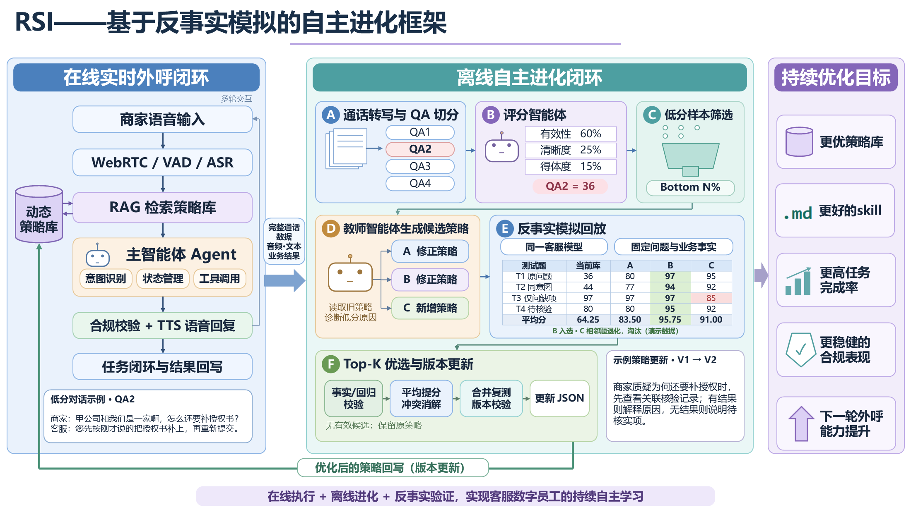
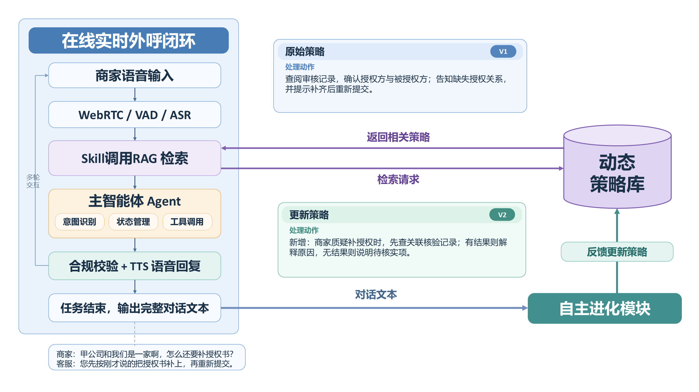
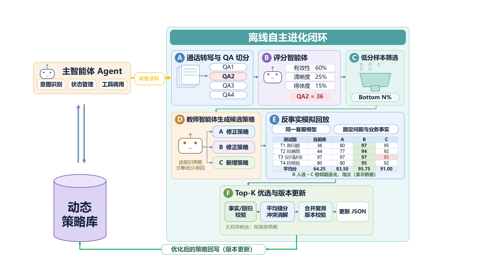
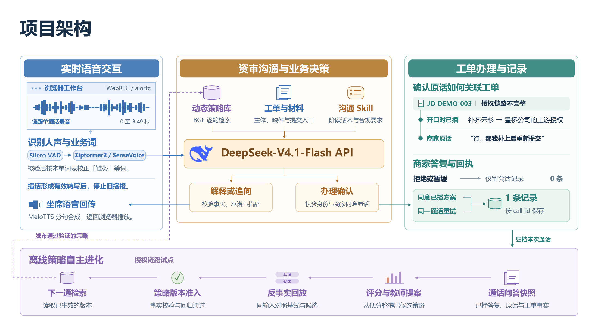
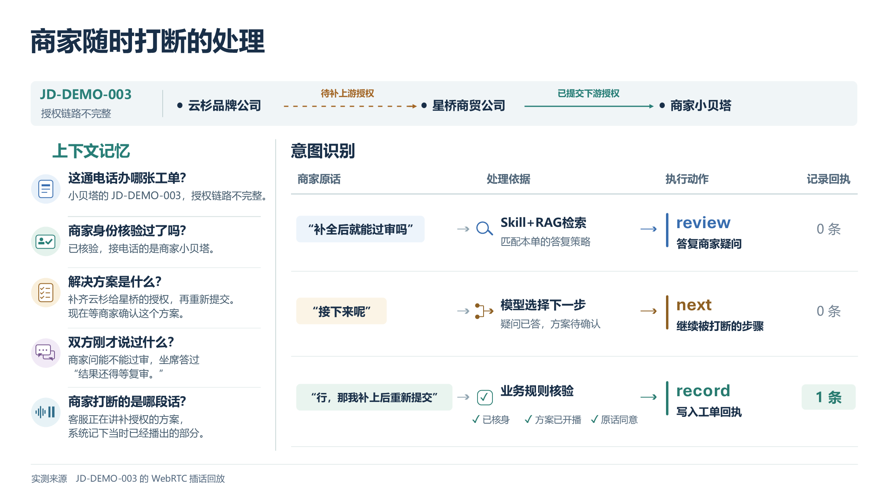

  <strong><a href="./智语外呼答辩.mp4?raw=true">下载讲解视频</a></strong>　·　
  <strong><a href="./项目说明书.pdf">阅读项目书</a></strong>　·　
  <strong><a href="./答辩PPT.pptx?raw=true">下载答辩 PPT</a></strong>　·　
  <strong><a href="./项目源代码.zip?raw=true">下载源码</a></strong>

商家在电话里问「补齐后就能过审吗？」，客服先答「结果还得等复审」，再接着说明缺的是哪两家公司之间的授权。商家可以在方案播完前直接同意，客服把确认原话和整改办法记回这张工单。

工作台覆盖品牌类目不符、授权书内容不完整、授权链路不完整、授权到期和法人证件五类模拟资审工单。

## RSI 自主进化

「甲公司和我们是一家，怎么还要补授权书？」如果客服只是重复补件步骤，商家的疑问仍在。团队以**授权链路不完整**为试点，让系统从这样的低分答复中提出新策略。在这个例子里，新策略要求客服先查两家公司的关联核验记录，再解释补件原因或说明哪项关系仍待核实。

<strong>在线外呼怎样选用一条策略？</strong>

每轮先按工单场景和办理阶段筛选，再用 BGE 检索相关策略。DeepSeek 结合商家刚问的问题、已提交的材料和之前播出的答复，决定继续解释、追问还是回到办理确认。

<strong>怎样验证新策略值得用于下一通电话？</strong>

评分智能体从有效性、清晰度和得体度评价已播答复，教师智能体分析低分原因并提出候选。反事实回放固定客服模型、工单事实和问题，让原策略与候选分别作答。除了原问题，还检查同义问法和相邻任务。通过事实与回归校验的策略才进入新版本，供后续通话检索。图中的候选得分为演示数据。

## 系统架构

浏览器通过 WebRTC 收发语音，本地完成语音检测、中文转写和语音合成。DeepSeek 读取当前工单和已播对话，按资审沟通 Skill 与检索到的策略组织答复。商家打断时，系统保留身份核验状态、当前方案和播报进度，答完插问还能接着办理。收到明确同意后，办理服务才向 SQLite 写入记录。

<strong>看一次打断之后的三种办理动作</strong>

同一张授权链路工单里，「补全后就能过审吗」触发答疑，「接下来呢」让客服接回办理步骤，「行，那我补上后重新提交」才触发写入。

## 五张工单的通话验收

团队用同一组 13 段合成录音驱动浏览器麦克风，每张工单各走两条路径，在实际 WebRTC 通话结束后按通话编号核对数据库。

| 商家在电话里的选择 | 复测通过 | 工单办理记录 |
| --- | ---: | --- |
| 明确拒绝，结束通话 | 5 / 5 通 | 每通 0 条 |
| 打断插问，继续办理，明确同意，写入超时后重试 | 5 / 5 通 | 每通 1 条，重试返回同一编号 |

复测共完成 23 个业务轮。从商家说完到浏览器听到客服答复，首响中位数（P50）为 **1.92 秒**，第 95 百分位（P95）为 **2.80 秒**。

## 戴上耳麦试一通

1. 在 64 位 Windows 上解压源码包。要使用 DeepSeek 对话，请先在本机设置 `DEEPSEEK_API_KEY`。使用规则演示模式可直接进入下一步。
2. 双击 `双击启动.cmd`。首次启动会联网下载依赖与语音模型，就绪后自动打开工作台。
3. 在工作台选择「授权链路不完整」，点击「发起呼叫」并允许使用麦克风。确认身份后，可以在方案播报中插问「补齐后就能过审吗？」，再明确同意，查看这张工单的办理记录。
